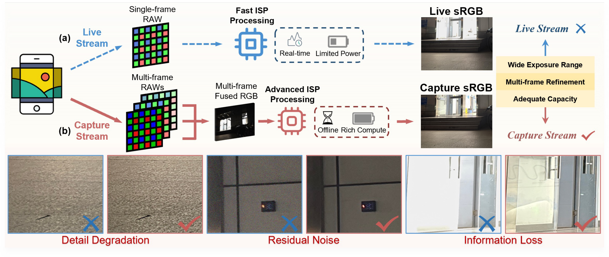

<h2 align="center">LC-ISP Benchmark: Learning Advanced ISP with Live and Capture Streams</h2>

<p align="center">
  <a href="https://scholar.google.com/citations?user=JGz8LPoAAAAJ">Kai Chen</a> &middot;
  <a href="https://scholar.google.com/citations?user=SpYwv_AAAAAJ">Junyu Lou</a> &middot;
  <a href="https://scholar.google.com/citations?user=tyYxiXoAAAAJ">Jinhua Zhang</a> &middot;
  <a href="https://scholar.google.com/citations?user=q4uALoAAAAAJ">Weiyi You</a> &middot;
  <a href="https://scholar.google.com/citations?user=-kSTt40AAAAJ">Shuhang Gu</a><sup>*</sup>
</p>

<p align="center">
  University of Electronic Science and Technology of China
</p>

<p align="center">
  <sup>*</sup> Corresponding author
</p>

<p align="center">
  
  <a href="https://lc-isp-benchmark.kkchen318.chatgpt.site">
    
  </a>
  <a href="https://github.com/CVL-UESTC/LC-ISP">
    
  </a>
  <a href="https://pan.baidu.com/s/1lId0WNqjVILaTnANBtMbFQ?pwd=jd6v">
    
  </a>
</p>

LC-ISP provides aligned live- and capture-stream data for learning RAW-to-sRGB
image processing. Each sample includes RAW, ProRAW, preview, and reference images.

<p align="center">
  <a href="docs/assets/live-capture-streams.pdf">
    
  </a>
</p>

For the dataset showcase, please visit the [LC-ISP project page](https://lc-isp-benchmark.kkchen318.chatgpt.site).

## Dataset

Download the dataset from [Baidu Netdisk](https://pan.baidu.com/s/1lId0WNqjVILaTnANBtMbFQ?pwd=jd6v).

**Extraction code:** `jd6v`

The dataset contains **48,546 training samples** and **5,400 validation samples**.

### Download and extract

Download all files into the same directory:

- `train-0001.tar` through `train-0008.tar`
- `test-0001.tar`
- `train_ids.txt` and `test_ids.txt`
- `train_meta.json` and `test_meta.json`
- `extract.sh`

Run the extraction script:

```bash
bash /path/to/LC-ISP-data/extract.sh
```

The extracted directory has the following structure:

```text
LC-ISP-data/
├── train_ids.txt
├── test_ids.txt
├── train_meta.json
├── test_meta.json
└── data/
    ├── train/
    │   ├── 0000_0.raw
    │   ├── 0000_0_pro.raw
    │   ├── 0000_0.png
    │   ├── 0000_0_pro.png
    │   └── ...
    └── test/
        └── ...
```

Each sample contains four aligned files:

| `<id>.raw` | `<id>_pro.raw` | `<id>.png` | `<id>_pro.png` |
| --- | --- | --- | --- |
| RAW image | ProRAW image | Preview image | Reference image |

The validation split uses the `test` filenames and directory shown above. The
TXT files list sample IDs. The corresponding JSON files contain file paths,
camera parameters, and crop coordinates. File paths in the JSON files are
relative to `LC-ISP-data/data/`.

## Models

The Dual-Stage ISP baseline combines `RestorationNet` and `EnhancementNet`.
The network is defined as `DualStageISP` in `dual_stage_isp.py`.

| Model | Config | Params (M) | GFLOPs |
| --- | --- | --- | --- |
| Base | [base.json](configs/base.json) | 23.984 | 42.58 |
| Medium | [medium.json](configs/medium.json) | 6.359 | 10.98 |
| Lite | [lite.json](configs/lite.json) | 0.535 | 2.50 |

GFLOPs are measured on 448 × 448 RAW inputs, packed into 4 × 224 × 224 tensors,
using 2 × MACs. Model settings are defined in `configs/`.

## Installation

Python 3.10, PyTorch 2.6.0, and torchvision 0.21.0.

```bash
pip install -r requirements.txt
```

## Training

Run the following commands from the project root after installing the requirements.

Single GPU:

```bash
bash run/train.sh /path/to/LC-ISP-data \
    --config configs/base.json \
    --save_model_path checkpoints/base \
    --tb_log_dir logs/base
```

Multiple GPUs:

```bash
CUDA_VISIBLE_DEVICES=0,1,2,3 NUM_GPUS=4 bash run/train.sh /path/to/LC-ISP-data \
    --config configs/base.json --batch_size 6 \
    --save_model_path checkpoints/base --tb_log_dir logs/base
```

The batch size is per GPU. Training uses Adam for 150 epochs with a five-epoch
warmup and cosine learning-rate decay. VGG-19 weights are downloaded on first
use; pass `--vgg_weights /path/to/vgg19-dcbb9e9d.pth` to use a local file.

Resume training:

```bash
bash run/train.sh /path/to/LC-ISP-data \
    --ckpt checkpoints/base/last_model.pth \
    --save_model_path checkpoints/base --tb_log_dir logs/base
```

## Evaluation

Evaluate a trained checkpoint on the validation split:

```bash
bash run/test.sh /path/to/LC-ISP-data checkpoints/base/last_model.pth \
    --config configs/base.json \
    --save_img_path results/base
```

Use the matching config and checkpoint for Medium or Lite. Add `--ssim --lpips`
to compute SSIM, MS-SSIM, and LPIPS alongside PSNR. Images are saved as PNG,
alongside `metrics.json`, in the output directory.

New training checkpoints include the model configuration and can be loaded
without `--config`.
